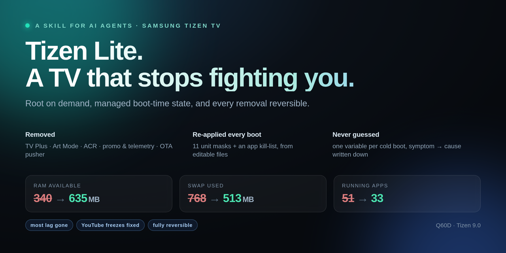
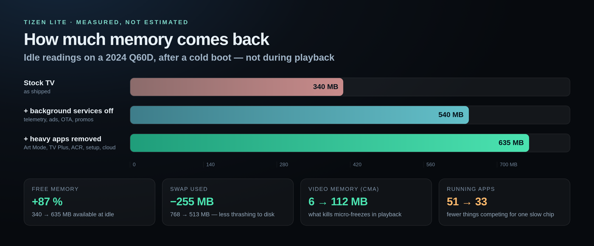
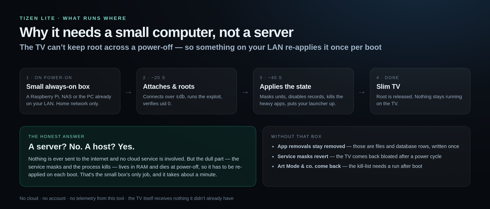

<div align="center">



# Tizen Lite

**A skill for AI agents that slims a Samsung Tizen TV — reversibly.**

[](https://www.tizen.org)
[](#)
[](#design)
[](#restore)
[](#privacy-what-stopped-phoning-home)
[](AGENTS.md)
[](LICENSE)

</div>

A Tizen TV ships with dozens of services you never asked for: ad engines, telemetry, a live-channel
promo service, a shopping channel, art mode, an OTA pusher — all competing for one weak SoC.

**Tizen Lite is a skill, not a pile of scripts.** Hand it to an agent and it knows the platform: what is
safe to cut, what silently breaks playback, how to prove a change with a cold boot, and how to undo it.
The runnable tools are here too — but the thing that makes it work is the method.

Everything here was verified on one physical **Samsung QE75Q60** (Q60D, 2024, 75") over repeated
cold boots. If yours is the same model year, the unit names and app ids below are likely to match; on
another set they are a starting hypothesis, not fact.

<sub><b>What this covers:</b> Samsung Tizen TV debloat · remove ads and TV Plus · ACR and telemetry off ·
OTA blocked · lag and stutter · Tizen root over sdb · Free My TV launcher · TizenTube · reversible
app removal · quick-settings and DRM kept working</sub>

<br>

<sub><b>Stock → after</b>, measured <b>right after a cold boot</b>, at idle. More RAM/CMA free is better;
less swap and fewer apps is better. <a href="#long-idle-reality">What changes after days of uptime ↓</a></sub>

<table>
<tr>
<td align="center" width="25%"><b>340 → 635 MB</b><br><sub>RAM available <i>(more is better)</i></sub></td>
<td align="center" width="25%"><b>768 → 513 MB</b><br><sub>swap used <i>(less is better)</i></sub></td>
<td align="center" width="25%"><b>51 → 33</b><br><sub>running apps <i>(fewer is better)</i></sub></td>
<td align="center" width="25%"><b>6 → 112 MB</b><br><sub>CMA free <i>(more is better)</i></sub></td>
</tr>
</table>

Most of the interface lag goes with it — **not all of it**. The panel's SoC is still slow and a cold
app launch is still a cold app launch. YouTube freezes are handled by
[TizenTube](https://github.com/reisxd/TizenTube), not by the debloat.

**What it does not do:** it does not make the TV fast in absolute terms, it does not touch picture
quality or HDMI, it does not remove *every* ad (Samsung's UI still exists behind your launcher),
and it does not stop the TV talking to Samsung.

> [!WARNING]
> For a TV you own. **Will it brick?** In this work it never did, and nothing is ever deleted — app
> directories are *moved* to `/opt/usr/share/tv-root-backups/`, and every database edit is preceded by a
> copy. The realistic worst case is one broken feature until you run `./restore.sh`. Rooting is
> unofficial: a future firmware can close the hole, and the warranty argument is yours to make.

---

## Plain English, no jargon

**The problem.** A smart TV is a slow computer running far more software than you asked for. Think of
RAM as counter space: Samsung fills most of the counter with helpers — an ad engine, a viewing-data
fingerprinter, a channel that plays "free" shows, an art-mode slideshow, an update checker — and then
wonders why there's no room to chop when you press Home.

**What this does.** It turns off the helpers you never use and uninstalls the heaviest ones, then puts
your own app grid in place of Samsung's. Nothing is deleted forever: removed apps are moved to a backup
folder and can be put back.

**What you'll notice**

- Home responds immediately instead of after a pause.
- Scrolling the app list stops stuttering; menus stop "catching".
- Prime and YouTube stop micro-freezing (video decoding gets the memory it needs).
- TV Plus stops turning itself on — no more surprise channels.
- Fewer things watching: the content-recognition service that fingerprints what's on screen is gone.

**What you won't notice**

- Picture quality and the PS4/HDMI input are untouched.
- The TV is still a 2024 TV: cold-launching Netflix still takes several seconds.
- Not every ad disappears — Samsung's own UI still exists behind your launcher, and YouTube ads are
  handled by [TizenTube](https://github.com/reisxd/TizenTube), not by this.



---

## Do I need a server?

**Nothing on the internet — but yes, a small always-on computer at home.** Fair warning: call it a host
or a "server", it is still a box you leave running (a Raspberry Pi, a NAS, or the PC you already have on)
with two small services on it. What it is *not*: a cloud account, a VPS, or anything reachable from
outside your network.

The reason is mechanical: the TV can't keep root after a power-off, and service masks live in RAM. So
once per boot, something has to reconnect, re-acquire root (~20 s), re-apply the state (~40 s), and then
step away. Root is not held afterwards.



| Without the host | Still true |
|---|---|
| Uninstalled apps stay uninstalled | ✅ files and database rows are written once |
| Unit masks and process kills revert | ❌ they are RAM-only, per boot |
| Art Mode / TV Plus returns | ❌ the kill-list needs a run after boot |

So: **one-time work for the removals, recurring one-minute job for the masks.** If you never power-cycle
the TV, the host can be retired until you do.

---

## Before you start

**What this actually is.** A *skill* is a folder an AI agent reads to learn a job — here, `skills/tizen-lite/`.
It contains the instructions, the safety rules and the scripts that carry them out. You can hand it to an
agent, or you can run the scripts yourself; both paths use the same files.

**What you need, before any command below works:**

| # | You need | How to tell |
|---|---|---|
| 1 | A TV you own, in **Developer Mode** | TV: `Apps` → type `12345` → *Developer mode* on → reboot the TV |
| 2 | **This computer's IP whitelisted** on the TV, same screen ("Host PC IP") | Run `./scripts/tv-doctor.sh` after step 3 of the quick start — it prints *"this computer is 192.0.2.10"*, which is the number you type there |
| 3 | `sdb` (Samsung's debug bridge) on this computer | `sdb version` prints something |
| 3b | **Python ≥ 3.7** and systemd on this computer | `python3 -V` prints 3.7 or newer (Debian 11 and Ubuntu 20.04 are fine) |
| 4 | A working **root chain** — [samsung-tv-root](https://github.com/chris-ritsen/samsung-tv-root) at `/usr/local/bin/samsung-tv-root` | `ls /usr/local/bin/samsung-tv-root` |

Without #4 nothing here can change anything on the TV. It is a separate project, and
[docs/rooting.md](docs/rooting.md) covers the chain, its limits and what root does and does not buy.

**Which machine a command runs on.** Two computers are involved and it matters:

| Runs on **this computer** (the "host" — a Pi, NAS or PC on your LAN) | Runs on **the TV** |
|---|---|
| `install.sh`, `restore.sh`, `scripts/tv-doctor.sh`, `agent/audit.sh`, `bin/tv`, `bin/tv-root-apply` | the `mv`, `sqlite3` and `systemctl` commands shown inside the [Restore](#restore) manual recipe |

The host is not a server in the internet sense: nothing is uploaded, there is no account, and it only
needs to be on the same LAN as the TV.

---

## Quick start — in this order

```bash
# 1. get the files
git clone https://github.com/tw0m8/tizenlite && cd tizenlite

# 2. install the host-side tools, state files and systemd units
sudo ./install.sh

# 3. tell it where the TV is
sudo nano /etc/default/tv-root        # set TV_HOST=<your TV's LAN IP>

# 4. check everything, including one real root acquisition (~20 s)
./scripts/tv-doctor.sh --deep

# 5. once step 4 is green, re-apply the state after every TV power-on
sudo systemctl enable --now tv-root-watchdog

# 6. see what the TV looks like right now (read-only)
./agent/audit.sh
```

Step 4 is the one that matters: it prints a ✓ or ✗ per prerequisite in plain language, names this
computer's IP so you know what to whitelist, and ends with a numbered "do this next" list. **Exit code 0
means you are ready**; anything else means step 4 tells you what to fix before touching the TV.

Stuck? [FAQ](docs/faq.md) answers "will it brick", "do I need a server", "will Netflix still work" and
"does my TV qualify"; [compatibility](docs/compatibility.md) says which models this has actually run on.

---

## Where things are

| I want to… | Run this | On |
|---|---|---|
| know why nothing works yet | `./scripts/tv-doctor.sh` | host |
| see the TV's current state (read-only) | `./agent/audit.sh` | host |
| undo one app | `./restore.sh --app <appid>` | host |
| undo everything | `./restore.sh --all --yes` | host |
| see what is backed up | `./restore.sh --list` | host |
| install on a new host | `sudo ./install.sh` | host |
| remove from this host | `sudo ./install.sh --uninstall` | host |
| refresh the single-file agent bundle | `./build-bundle.sh` | host |

---

## Words used here

| Word | Means |
|---|---|
| **host** | the always-on computer on your LAN (Pi, NAS, PC) that re-applies state after each boot — not an internet server |
| **sdb** | Samsung's debug bridge, the same tool the official Tizen SDK ships; the transport for root and for the agent |
| **Developer Mode** | a hidden TV menu (`Apps` → `12345`) that opens port 26101 for `sdb` and lets a whitelisted computer in |
| **root** | administrator rights *on the TV* for one command at a time. Not a jailbreak of the bootloader; it is lost when the command ends |
| **unit** | one background service managed by `systemd`, e.g. `swu-auto-upgrade` |
| **mask** | tell `systemd` never to start a unit. Reversible, and on this TV it only lasts until power-off |
| **app id** | the package name of a TV app, e.g. `com.samsung.tv.tvplus` — what `restore.sh --app` takes |
| **cold boot** | power the TV fully off and on again (not the remote's standby). The only proof a change survives |
| **OTA** | over-the-air firmware update — the TV updating itself |
| **ACR** | Automatic Content Recognition: Samsung fingerprinting what is on screen to identify what you watch |
| **CMA** | the memory region video decoding uses. More free CMA = fewer playback stutters |
| **swap** | disk space used when RAM runs out. Less used = less thrashing, which is what "lag" often is |
| **watchdog** | the host service that notices the TV powered on and re-applies the state, once per boot |
| **JSON** | a machine-readable text format; `agent/audit.sh` prints it so an agent can read the state without screenshots |

---

## At a glance

| ✅ What you get | ⛔ What it will not do |
|---|---|
| Home key opens **your** tile grid ([Free My TV](https://github.com/simbasjungles/free-my-tv)) instead of Samsung's ad-filled Home | Make the TV fast in absolute terms — a picture takes ~2–3 min after power-on (134 s measured here) and cold starts are SoC-bound |
| Interface stops stuttering: fewer background services, and `CmaFree` (the memory video decoding needs) climbs from ~6 MB to >100 MB | Fix picture quality, HDMI throughput or the PS4 input |
| TV Plus channels, Art Mode, ACR viewing-data recognition, promo and telemetry services stop running | Stop *every* ad — Samsung's UI still exists behind the scenes; TizenTube handles YouTube |
| The OTA pusher stops, so the TV stops phoning home for updates | Free you from having to re-check firmware every few weeks |

If your model is not in [compatibility.md](docs/compatibility.md), the *method* still applies but every
unit name and app id is an unverified guess for your model year — verify each one with a cold boot before
trusting it.

There is **no screenshot here on purpose.** This firmware ships a stripped `enlightenment` with no
screenshot support and no capture binary, so anything UI-shaped in this README would be a fabricated
render. What changes is behaviour, not pixels.

---

## Before and after, measured

Idle readings, same set, repeated cold boots:

| Stage | RAM available | Swap used | CMA free | Running apps |
|---|---:|---:|---:|---:|
| Untouched | 340 MB | 768 MB | 6.5 MB | 51 |
| + service masks, ads/telemetry off | 540 MB | 634 MB | 72 MB | 41 |
| + Art Mode, TV Plus, ACR, setup/tap, cloud, AirPlay | **635 MB** | **513 MB** | **112 MB** | **33** |

The two biggest single wins were **Art Mode** (`art-app` 128 MB + `home.art` 59 MB) and **TV Plus**
(live-channel service + its standalone app).

<details id="long-idle-reality">
<summary><b>Long-idle reality: the cuts hold, the idle pool shrinks</b></summary>

<br>

Every number above is a **cold-boot** measurement, because that is when the TV is comparable to the
stock figures. On a set left on for ~10 hours the same cuts are still in place — the removed apps are
gone, the units stay masked — but the idle pool drifts back to roughly **300 MB free and ~38 running
apps**, because Samsung starts extra services later in the session (multi-assistant, the notification
service, a Chromium instance, and `mde-framework`, which `launchpad-process-pool` respawns despite the
kill-list).

So: reboot for the headline numbers, and treat a long-idle TV as a separate measurement. The kill-list
is a boot-time net, not a permanent supervisor — see `docs/app-uninstall.md`.

</details>

<details>
<summary><b>⚠️ What you must not remove — found the hard way, one boot bisect at a time</b></summary>

<br>

| Don't touch | Why | How it fails |
|---|---|---|
| `aaa_tvs_deamon` | Prime Video / PlayReady licence path | App opens, every video fails: *"Something went wrong. Please try again later."* |
| `home.sidebar` + `contentservicemanager` | quick-settings panel providers | Panel opens, every control reads *"Preparing… Please try again later"* |
| `dta-agent` | installs the CDM/PlayReady trusted app | DRM playback dies for a few MB saved |
| `sdbd` | the root transport itself (starts ~121 s in) | root acquisition fails, nothing applies |
| `csfs` | core content framework | broad instability, UI won't settle |

Nothing in these names suggests DRM or UI — and this firmware keeps **no logs** to help you, which is
why the repo ships symptoms rather than rules.

</details>

---

## Privacy: what stopped phoning home

A retail Tizen TV watches more than you think — it fingerprints what is on screen, detects presence,
uploads crash and usage telemetry, and re-registers itself with Samsung on every boot. These are the
pieces this skill removes or masks:

| Component | What it does | Status |
|---|---|---|
| **`vif`** (Visual Information Framework) | **ACR** — fingerprints on-screen content to identify what you watch | app removed |
| `context-aware-service` + `-agent` | presence / context detection (who is in front of the TV) | app removed |
| `wifi-presence` | presence detection over Wi-Fi | unit masked |
| `reporterCA` | Samsung cloud reporting | unit masked |
| `emergency-log-transmitter` | crash and log upload | unit masked |
| `ua-manager` (User Awareness Framework) | user-awareness telemetry | unit masked |
| `adagent-service`, `canalysis-service`, `sp-kpi` | ad delivery and analytics | stopped |
| **TV Plus** | ad-supported live channels (the "free TV" rows) | uninstalled |
| `swu-auto-upgrade` | firmware auto-updater, phones home on a schedule | unit masked |

**What this is:** fewer processes that can observe you, fingerprint content, or report usage — verified
by cold boot, not by inspecting packets.

**What this is not:** a firewall, a VPN, or a claim that the TV no longer talks to Samsung. The store,
Samsung account and app updates still use Samsung endpoints; anything network-level is a separate job
(DNS filtering, router rules). I did not capture or analyse traffic here, so treat this as *fewer
observers running*, not *verified silence*.

---

## Import it anywhere

Pick the row that matches your agent — nothing to configure, nothing to install.

| Target | What to do |
|---|---|
| **Any chat / unknown agent** | attach or paste **[`dist/tizen-lite.skill.md`](dist/tizen-lite.skill.md)** — one file, ~30 KB, the skill + contract + manifest + playbooks inlined |
| **Claude Code** | clone the repo and it just works: `CLAUDE.md` is read automatically and `.claude/skills/tizen-lite/SKILL.md` is auto-discovered as a skill |
| **Claude.ai / any Skills UI** | upload the folder `skills/tizen-lite/` — `SKILL.md` carries the `name`/`description` frontmatter those UIs parse |
| **Codex, Cursor, Aider, generic** | `AGENTS.md` at the repo root, or `.cursor/rules/tizen-lite.mdc` for Cursor |
| **Hermes** | copy `skills/tizen-lite/` into the skills directory and reload |
| **[skills.sh](https://skills.sh), [SkillsMP](https://skillsmp.com), [LobeHub](https://lobehub.com/skills)** | publish the same `skills/tizen-lite/` folder — these index `SKILL.md` packages directly |

The bundle is generated, not hand-written — after editing the skill or the manifest, run
`./build-bundle.sh` and it refreshes `dist/` and the Claude Code copy together.

Inside the repo, the agent-facing files are:

| File | Role |
|---|---|
| [`AGENTS.md`](AGENTS.md) | operating contract: read order, discovery, invariants, boot-bisect protocol, verification contract, report format |
| [`agent/manifest.json`](agent/manifest.json) | the same rules, machine-readable — including the **symptom** each wrong removal produces |
| [`agent/audit.sh`](agent/audit.sh) | one read-only command → JSON: reachable, rooted, which units are really down, memory, launcher offset |
| [`agent/playbooks/`](agent/playbooks) | `disable-a-unit`, `remove-an-app`, `diagnose-broken-feature`, `reclaim-memory` |

Paste this to get a useful answer out of it:

> Read `AGENTS.md` and `agent/manifest.json`. Run `./agent/audit.sh`. Then tell me the three
> highest-value changes I can make without breaking anything — evidence, risk, rollback for each.
> Do not change anything until I approve.

The design assumption: the agent **cannot ask you how the platform works** and **cannot read logs**
(there are none). So a wrong removal announces itself as *"Something went wrong"* or *"Preparing…"*, and
the manifest maps those exact strings to the cause.

---

## Design

- **Root is on demand; the TV is stock when idle.** No resident daemon holds root. After each power-on
  the host watchdog attaches over `sdb`, re-acquires root (~17–20 s), applies managed state, starts the
  polling agent, then leaves the TV alone.
- **State is declarative.** `tv-root-apply` re-asserts everything each cycle, so a partial failure heals
  on the next boot instead of drifting. One `ITEM|group|name|state` line per check, easy to script and diff.
- **Two debloat layers.** Systemd units are masked at runtime (`/etc` is read-only on retail firmware).
  App removals need the package record disabled **and** the directory moved out of `/opt/usr/apps`,
  because `launchpad-process-pool` restarts anything it can still exec.
- **The relay adds no inbound port.** The TV polls this host, so nothing new listens on the TV. Note that
  `sdbd` (port 26101) is already listening as part of Developer Mode — that is the root transport, not
  something this toolkit opens, and it is reachable from the LAN whenever Developer Mode is on.
- **This host *does* listen**, on `0.0.0.0:8899`, and that listener can run commands **as root on the
  TV**. It is gated by a token in `/etc/tv-agent.token` (mode 600) — so anyone who reads that file can
  drive the TV as root. On a shared LAN, bind the relay to one interface or firewall the port; the
  token is the only thing between a guest device and a rooted TV.

---

## Repository map

<details>
<summary>Show the file tree</summary>

<br>

| Path | What it does |
|---|---|
| `bin/tv` | compact CLI — `status run sql apps log svc vconf apply power wake sdb dns` |
| `bin/tvlib.py` | shared core: DB queries, logs, agent transport, WoL, DNS |
| `bin/tv-root-apply` | idempotent state applier: home app, privacy/OTA flags, unit masks, app records, kill-list |
| `bin/tv-root-watchdog` | host unit: per power-on → sdb reattach → root → launcher push → apply |
| `bin/tv-agent*` | outbound polling agent: ~1 s command channel, opens no port on the TV |
| `config/*.example` | settings, masked units, killed processes — the only files you edit |
| `install.sh` · `restore.sh` | put the host together · take every change back off |
| `scripts/tv-doctor.sh` | prerequisite check that ends with "do this next" |
| `systemd/` | the two units: watchdog (re-applies each boot) and agent relay |
| `agent/` | agent layer (guide, manifest, audit, playbooks) |
| `docs/` | rooting, boot & startup, debloat/modding, app uninstall, sdb audit |
| `skills/` | the two agent skills this skill was distilled from |
| `scripts/` | doctor (prerequisites) + connectivity and UEP capability probes |

</details>

---

## Method notes (learned, not guessed)

<details>
<summary>Show the seven traps that cost the most time</summary>

<br>

- **Bisect with boots, not live masks.** Stopping a unit while the TV is up does not reproduce the
  failure — an already-acquired licence or a rendered panel keeps working, so a live test says "works"
  even when that unit is the culprit. Starting it late doesn't repair it either.
- **There are no logs.** `journalctl`, `dlogutil` and `/var/log/dlog` are empty on this firmware.
- **Send the applier in chunks.** One ~13 KB compound command ran its first and last groups and silently
  skipped the middle, exit status still `0`. Keep chunks under ~4 KB and parse `ITEM|` per chunk.
- **`pkill -f` matches your own command line** and kills the session mid-script. Bracket the pattern
  (`org[.]tizen[.]art-app`) or anchor on a path segment your command doesn't contain.
- **UEP blocks unsigned scripts even as root** (`[uep][bash] the file is NOT signed!!`) — ship work
  inline, or as data fed to a signed interpreter (`sqlite3 db < file.sql`).
- **Validate generated shell before sending it** — `bash -n` on the built command; a quoting bug looks
  exactly like "root failed".
- **Judge boot by the launcher, not the REST API.** `/api/v2/` answering 30 s earlier means nothing to
  someone waiting for a picture — measure `/proc/<pid>/stat` field 22.

</details>

---

## Questions people actually ask

**Will this brick my TV?**
Nothing bricked the set this was developed on, and nothing is ever erased — removed apps are *moved*
to a backup directory and the database is copied before every edit. The realistic worst case is one
feature misbehaving until you restore it, which `restore.sh` does. That is evidence from one TV, not
a guarantee for yours.

**Do I need a server?**
No — a **host** on your LAN (a Pi, a NAS, the PC you already leave running). Nothing is uploaded
anywhere, no cloud account, no internet needed. See [Do I need a server?](#do-i-need-a-server).

**Will Netflix / Prime still work?**
They did here, including DRM playback, because the DRM path is deliberately left intact
(`dta-agent`, `aaa_tvs_deamon`, `playready`). If a streaming app breaks after a cut, you removed a
DRM component — restore it and reboot.

**Does it survive a firmware update?**
Masks and kills: yes, because the host re-applies them at every boot. App removals: a firmware update
usually reinstalls packages, so expect to redo those.

**Will the picture change?**
No. This touches software processes, not panel, HDMI or picture settings.

**Why is boot still slow?**
Because the bottleneck is the firmware's own serialized startup queue, not the services removed here.
Measured here: the REST API answers ~40 s in, the launcher appears at ~135–175 s.

**Do I lose the app store or my Samsung account?**
No. The store still works when you want it.

Full version: [`docs/faq.md`](docs/faq.md).

---

## Restore

Every removal is reversible, and there is a script for it — run on the **host**:

```bash
./restore.sh --list                 # what is backed up, what is masked, what is killed
./restore.sh --app com.samsung.tv.tvplus   # put one app back
./restore.sh --all --yes            # revert every removal and unmask every unit
```

Then power-cycle the TV and run `./agent/audit.sh` to confirm.

<details>
<summary><b>Manual recipe, if you would rather do it by hand</b></summary>

<br>

These run **on the TV**, inside a root command (`tv root '<commands>'`):

```bash
BK=/opt/usr/share/tv-root-backups/<change-set>
mv $BK/<pkg> /opt/usr/apps/
sqlite3 /opt/dbspace/.pkgmgr_parser.db \
  "UPDATE package_app_info SET app_disable='false', app_autorestart='true' WHERE app_id='<pkg>';"
```

Then drop the matching pattern from `/etc/tv-root-kill-procs` on the host, or the next apply kills it
again. `docs/app-uninstall.md` has the full sequence, including which directories belong to which
package.

</details>

---

## Built on / related projects

| Project | Role here |
|---|---|
| [Free My TV](https://github.com/simbasjungles/free-my-tv) | the launcher; this skill pins it as the Home app |
| [TizenTube](https://github.com/reisxd/TizenTube) | ad-free YouTube + the freeze fix; needs [TizenBrew](https://github.com/reisxd/TizenBrew) |
| [Tizen SDK `sdb`](https://developer.samsung.com/smarttv/develop/getting-started/using-sdk/tv-device.html) | transport for root acquisition and the agent |
| [samsung-tv-root](https://github.com/chris-ritsen/samsung-tv-root) | **the root chain** — required, not optional |
| [samsung-tv-tizen-root](https://github.com/DemonKingSwarn/samsung-tv-tizen-root) | reference for which preloads are safe to remove; its [2026 paper](https://github.com/DemonKingSwarn/samsung-tv-tizen-root/blob/main/ROOTING-RESEARCH.md) documents the same chain on newer hardware |
| [Bishop Fox — *Samsung Tizen OS, versions through 9.0*](https://bishopfox.com/blog/samsung-tizen-os-version-through-9-0/) | the vendor advisory behind the root chain: **command injection in SDB, affecting Tizen through 9.0** |
| [cleanyourtv — Tizen reconnaissance](https://github.com/Gathin23/cleanyourtv/blob/main/docs/devices/samsung-tizen.md) | the honest counterpoint: without root, Tizen debloat and launcher replacement do **not** work |

None are vendored. Check that the versions you install still match the unit/app ids in
`agent/manifest.json` before trusting a cut.

---

<div align="center">

**Not affiliated with Samsung or Amazon.** Unit names, app ids and paths differ between model years —
treat this as a worked example to verify on your own set. Rooting voids warranties and may break OTA
updates you might actually want.

<sub>MIT licensed · built by bisecting one TV, one cold boot at a time</sub>

<sub>If this saved you an evening, a star tells the next person it exists — and if you debloat a
different model, add it to [`docs/compatibility.md`](docs/compatibility.md).</sub>

<br><br>

<sub>Made with the help of <a href="https://www.deepseek.com">DeepSeek</a>.</sub>

</div>
